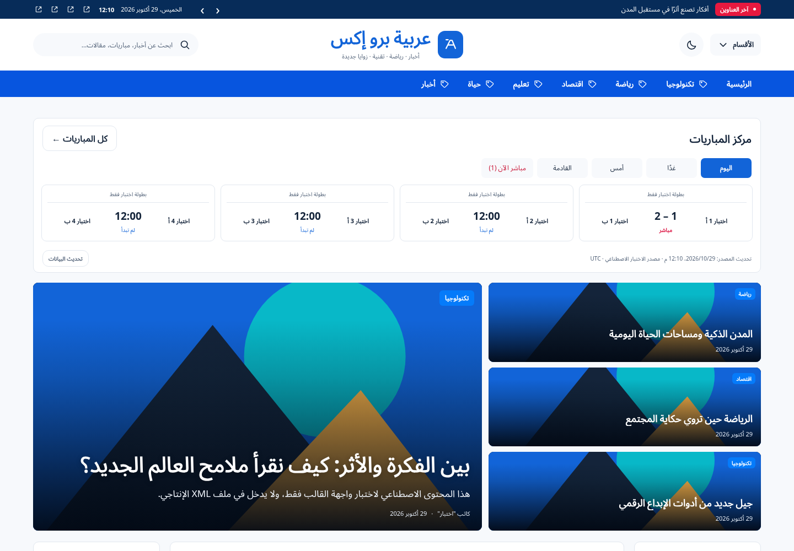
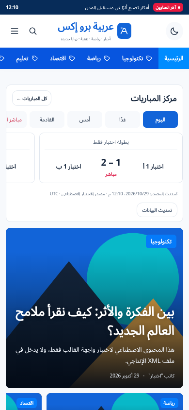

# ARABIA PRO X 2026 — تصميم المجلة المحدّث

قالب Blogger XML مستجيب للهاتف والحاسوب، بترتيب الصورة المرجعية: شريط أخبار كحلي، شعار متوسط، قائمة زرقاء، مركز مباريات اختياري، خبر كبير وثلاث بطاقات، ثم محتوى بين عمودين.

**لتركيب المظهر ارفع XML مباشرة، وليس ZIP.**

- [تنزيل قالب XML](ARABIA-PRO-X-2026.xml?raw=true)
- [تنزيل الحزمة الكاملة والأدلة](ARABIA-PRO-X-2026-PACKAGE.zip?raw=true)
- [تشخيص تعذّر تحميل المظهر في Blogger](BLOGGER-UPLOAD-TROUBLESHOOTING.md)

## المعاينة

الصور التالية معاينة محلية ببيانات مقالات ومباريات اصطناعية موسومة للاختبار، لا توجد هذه البيانات داخل XML. الموقع يعرض مقالاتك وبيانات المصدر الحقيقي بعد إعداده.

## التحقق

نجح 107 تحققات متصفح، و32 فحص بنية وصياغة، و6 اختبارات للوكيل. جميع المقاسات التسعة من 320 إلى 1920 بكسل اجتازت فحص تجاوز العرض. لم يتوفر حساب Blogger مخوّل لاختبار قبول الرفع. رسالة تعذّر التحميل العامة لم يُحسم سببها دون النص الكامل ونوع الملف المرفوع.

الحزمة تتضمن أدلة الإعلانات والمباريات والتخصيص والاختبارات، ووكيل بيانات آمنًا اختياريًا، وسبع مسودات صفحات قانونية. استكمل بيانات الناشر والصفحات والمحتوى الأصلي والحقوق قبل طلب AdSense؛ القالب لا يضمن قبول Google. الإعلانات والمباريات معطلة حتى تهيئتها، ولا توجد أسرار API أو بنرات تجارية تجريبية داخل XML.
